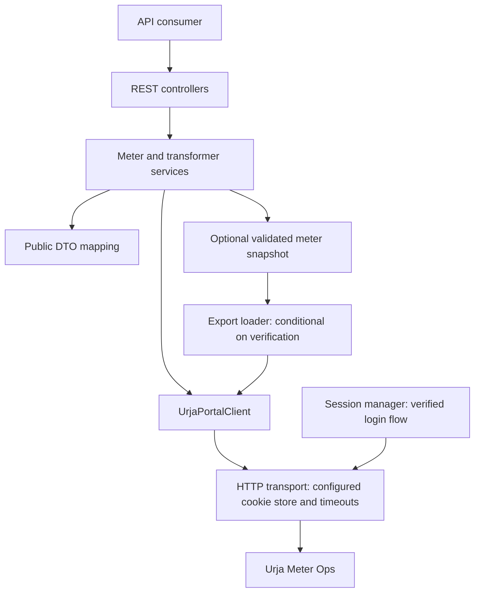

# Urjameter API: Reviewed Architecture

Review date: 12 October 2026. This is a proposed implementation architecture based on supplied captures, not a reconstruction of the portal's internal server architecture. No live portal requests or application tests were performed for this review.

## Implemented baseline (13 October 2026)

The initial application now implements all six public routes in this document, including the optional separate location route. Controllers delegate to services, a portal mapper, and one portal client with a Java HTTP transport and cookie store. Detail lookup uses a fresh export, not a cached snapshot. The snapshot in the planning diagram remains an optional future optimization.

Export is attempted using the captured cookie-authenticated GET; signing is not guessed. Errors invalidate local session state for a later login attempt, but no automatic expiry replay is implemented. Missing export records return an explicit 502 until portal absence semantics are verified. There is no database, frontend, or public consumer login. See the README for setup and current limitations. Local fixture tests verify the implementation; live portal compatibility remains unverified.

## Review verdict

One Spring Boot application with controllers, application services, response mapping, and an outbound portal client is appropriate to the assignment. A database is not required for the core scope. The earlier architecture needs three qualifications:

1. Export-backed detail lookup is conditional on reproducing export authentication/signing and validating completeness.
2. Live search and cached export can disagree; snapshot freshness must be visible and a snapshot miss must not automatically become a confirmed 404.
3. A globally deduplicated hierarchy tree is not justified by the captured data. Preserve each meter's path and report conflicts before attempting a reconstructed tree.

## Diagram

The mapper is used when returning portal or snapshot data; diagram arrows show component dependencies, not every response step. Session management is internal to the outbound integration. Consumers do not receive portal cookies or signing secrets.

## Public endpoint mapping

| Proposed public endpoint | Captured source | Decision |
| --- | --- | --- |
| `GET /api/v1/meters?search=...&page=1` | `/portal/meters/search?q=...&page=1` | Use live search and preserve the captured pagination metadata. Do not claim upstream page-size control without verification. |
| `GET /api/v1/meters/{id}` | Rich export record; UI detail HTML also contains structured page data | Prefer a validated export snapshot once export access is reproducible. No dedicated nameplate JSON endpoint was captured. |
| `GET /api/v1/meters/{id}/location` | `/portal/meters/{id}/geo` | Optional separate live location endpoint. Snapshot coordinates may also be included in meter details with snapshot freshness. |
| `GET /api/v1/meters/{id}/readings` | `/portal/meters/{id}/energy` | Return normalized readings. Do not claim interval consumption or upstream date filtering. |
| `GET /api/v1/transformers?page=1` | `/portal/dts?page=1` | Use live pagination. An all-transformer operation must traverse pages; the first page is not the complete list. |

These public routes are design choices. They are not claims that the portal exposes the same routes.

## Export findings and limitations

The captured export has 403 records, 403 unique meter IDs, and a reported total of 403. Every record includes keys for meter identity, installation fields, build, DT code, hierarchy, and geo. Key presence does not prove all field values are valid, and this count match does not prove future exports are always complete.

The `build` values are `legacy` for 238 meters and `v2` for 165. The captured geo and energy calls concern J100000. Before generalizing that client flow, inspect at least one normal v2 meter and compare its requests and response shapes. Do not infer a different endpoint from the build label alone.

The capture shows `/portal/keys` and a `signingSecret`, but does not establish export signing requirements. Keep any verified signing logic private inside the portal integration; do not expose a signing-key endpoint in the public API.

## Detail lookup and freshness

Once export is verified, a small immutable map indexed by meter ID is reasonable. Load it lazily, validate it, and replace it atomically. Keep `fetchedAt` and a configurable expiry. A database and scheduler are unnecessary initially.

A missing snapshot record is not automatically proof that a meter does not exist. Refresh a stale snapshot at most once before resolving absence. If completeness or existence cannot be established, return an upstream/data-availability error rather than a false 404. Establish the public not-found policy from verified portal behavior.

Live search can be newer than the snapshot. Document this consistency boundary and expose snapshot age on detail responses. If refresh fails, initially return an explicit upstream error rather than silently serving arbitrarily old data.

If export cannot be reproduced, investigate the actual browser detail flow. Search alone lacks installation type and full hierarchy, so it is not a complete fallback for the proposed detail response. HTML extraction is possible from the captured page but is more brittle and requires an explicit parser and verification.

## Hierarchy handling

The captured data has multiple full parent paths for the same codes: one circle code, all ten division codes, all fourteen subdivision codes, all nineteen substation codes, sixteen feeder codes, and twelve DT codes. This records conflicting paths in the supplied snapshot; it does not establish the physical network's true topology.

Some codes also have multiple names within export. DT-007 has a separate naming discrepancy between the transformer list and some exported meter paths.

For the core API, return each meter's source hierarchy path. For an optional hierarchy view, preserve parent-qualified occurrences and report conflicts, including multiple paths for a DT. Do not silently treat separate occurrences as confirmed separate physical assets, or merge all nodes by bare code. Transformer capacity can be joined by DT code only under an explicit policy that retains hierarchy/name conflicts.

## Transport and error handling

- Use one transport implementation with explicit cookie persistence, timeouts, and response validation.
- Keep login/renewal separate from data parsing. Determine expired-session signals before implementing automatic renewal.
- Distinguish a real HTTP redirect from the captured HTTP-200 SvelteKit action result containing status 303.
- Do not blindly follow redirects to a login page and interpret HTML as JSON data.
- Coordinate concurrent login/refresh attempts. Retry a read at most once after confirmed session recovery.
- Map empty search to a successful empty list. Map timeout, invalid JSON/HTML, and portal failure to clear upstream errors, not empty data.
- Normalize numeric strings without replacing missing or invalid values with zero. Preserve timestamp timezone uncertainty and energy-reading semantics.

## Scope and verification

Start with live search, live transformer pagination, a verified login/session flow, and normalized readings. Add full details through verified export access. Keep hierarchy reconstruction, durable indexing, advanced filtering, and consumer login outside the first implementation unless time and requirements justify them.

Before calling the architecture validated, verify login cookie issuance, export protocol, a legacy and a v2 meter, a nonexistent meter, session expiry, and malformed data behavior. Local tests should cover normalization, pagination, snapshot consistency, and failures using redacted fixtures.

See [Architecture assumptions and reasoning](./ARCHITECTURE_ASSUMPTIONS.md) for the evidence, reasoning, and remaining verification steps behind each choice.

## Export signing verified on 13 October 2026

The portal's served transformer-page module `/_app/immutable/nodes/4.2Bgc2kUI.js` confirms its export flow: fetch `/portal/keys`, take `data.signingSecret`, and compute HMAC-SHA256 using its UTF-8 bytes over `GET`, `/portal/export`, `page=1`, and the current Unix timestamp in seconds, joined with newline characters and no trailing newline. Send lowercase hexadecimal signature in `x-signature` and the timestamp in `x-timestamp` alongside the session cookie.

The implementation now follows this verified flow with a fresh key and timestamp per export. Earlier references in this document to unverified signing describe the prior investigation state. Key values, session values, and captured signatures are not committed. Session expiry and legacy/v2 differences still need separate verification.
