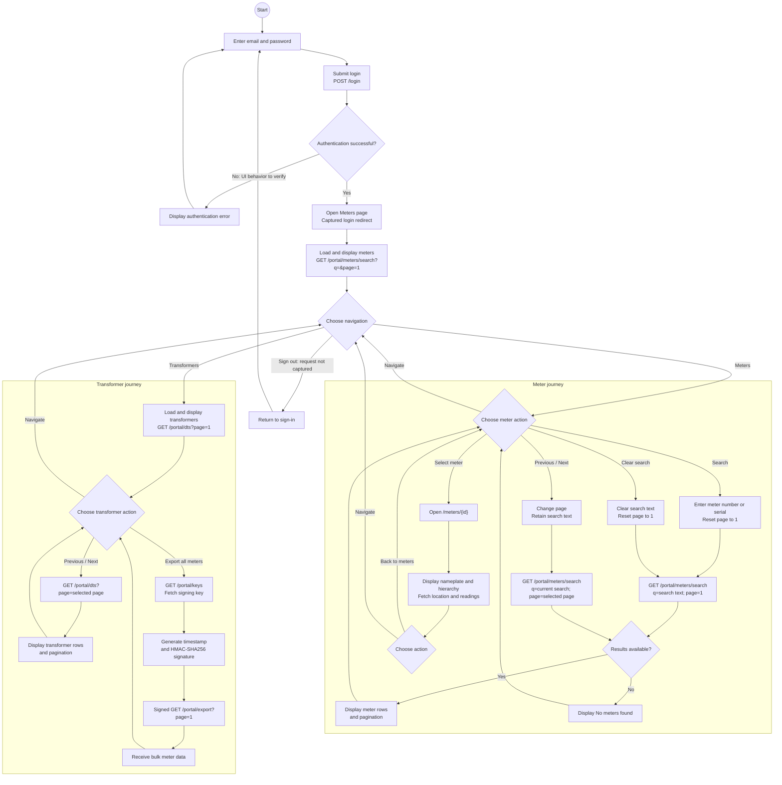
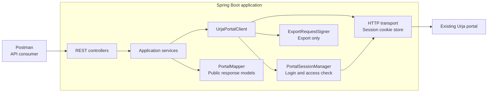
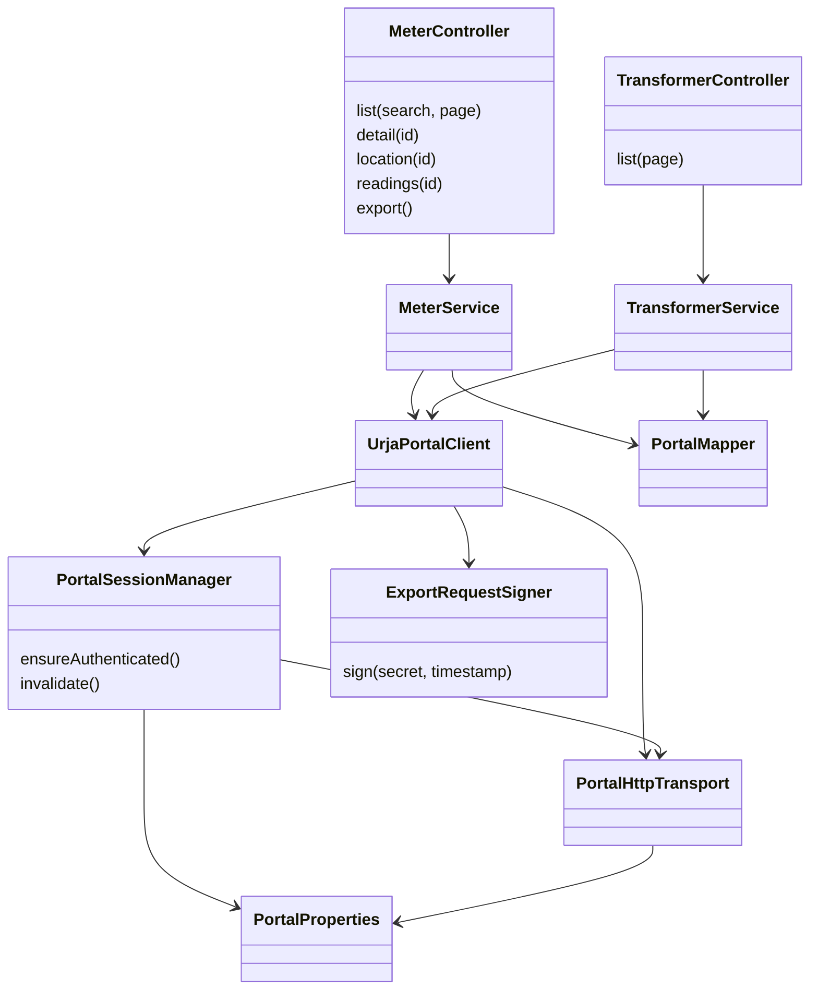
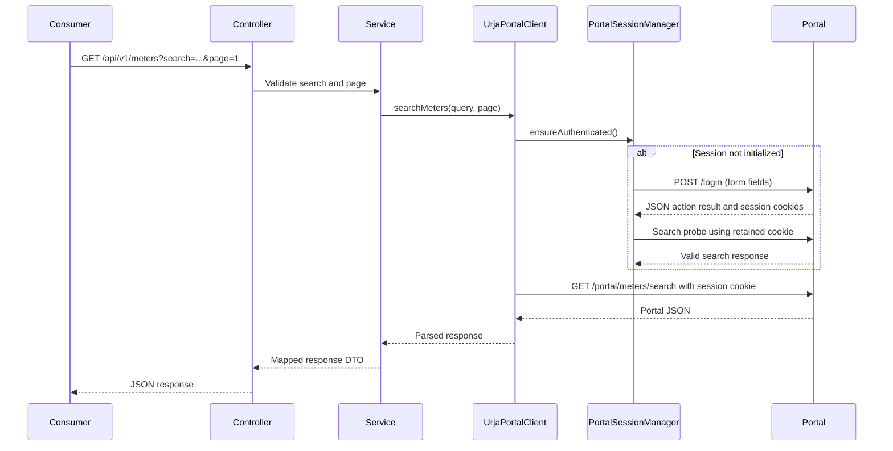

# Urjameter API

A Java 21 / Spring Boot service that provides a documented, read-only API over the Urja Meter Ops portal. Consumers can search meters, retrieve nameplate and hierarchy information, view coordinates and readings, browse transformers, and export meter data without using the original portal UI.

The design was developed in two levels: first the user journey and system flow, then the classes and responsibilities needed to implement that flow. The application is one Maven project with no database, frontend, or cache.

## 1. Portal journey

The existing portal uses **sign-in**, not a registration journey. After a successful sign-in it redirects to Meters. Meters and Transformers share navigation. This diagram describes the original portal experience that informed the API; it does not claim this Spring Boot project implements a web UI.



Rectangles represent actions and diamonds represent decisions. Shared navigation connects both journey groups.

Search and normal listing use the same portal endpoint: an empty query lists meters; a nonempty query searches. Pagination keeps the current query. Back navigation and switching sections are frontend behaviors and require no additional backend endpoints. The API manages its portal session internally, so API consumers do not submit portal credentials on each request.

## 2. Level one: system design



Arrows indicate dependencies and outbound calls. Responses return through the transport and client to the service, which maps them into public models and returns JSON through the controller. No upstream cookies or signing keys are included in public responses.

The portal is the source of data. Search, location, readings and transformer requests use its normal authenticated JSON routes. Full meter details currently come from a fresh bulk export rather than scraping the meter page HTML.

## 3. Level two: class design



| Component/package | Responsibility and relationship |
| --- | --- |
| `controller` | Defines the six public routes; delegates to services |
| `service` | Validates inputs, coordinates requests, and invokes mapping |
| `portal/UrjaPortalClient` | Encapsulates portal paths and export key/signature preparation |
| `portal/PortalSessionManager` | Performs lazy login and confirms access with a meter-search probe; coordinates initial login within one instance |
| `portal/PortalHttpTransport` | Sends HTTP requests, persists portal cookies, applies timeouts, rejects unexpected redirects/statuses/content types, and parses JSON |
| `portal/ExportRequestSigner` | Generates the browser-verified HMAC-SHA256 signature |
| `mapper/PortalMapper` | Normalizes fields, checks pagination and export completeness, and builds public models |
| `dto` | Separate ordinary Java classes with private fields, constructors, getters and setters; no records or database entities |
| `config` | Binds URL, credentials and timeouts to `PortalProperties` and registers it with Spring |
| `exception` | Produces consistent `application/problem+json` errors through `ApiExceptionHandler` |

Constructor injection and composition connect these components. Controllers contain no portal HTTP logic, and the transport contains no meter business decisions. Interfaces and inheritance are not added solely to demonstrate OOP; the actual design uses concrete injected classes. The earlier exploratory diagrams contain optional abstractions that are not all implemented.

### Login and authenticated reads



Login sends form-encoded `email` and `password`, `Accept: application/json`, and `x-sveltekit-action: true`. The captured successful response is HTTP 200 with an action result describing a 303 redirect; the application checks that result and probes authenticated data access. It does not automatically follow redirects to a login HTML page.

### Signed export and meter details

The client fetches `/portal/keys` under its session, reads `data.signingSecret`, and signs this exact message using HMAC-SHA256:

```text
GET
/portal/export
page=1
<current Unix timestamp in seconds>
```

The lines are joined with newline characters, without a trailing newline. The request to `/portal/export?page=1` sends `x-timestamp` and a lowercase hexadecimal `x-signature`, together with the session cookie. The key and signature are generated dynamically; captured values are not hard-coded. Export count must match its reported total and meter IDs must be unique.

For a single-meter detail request, the service retrieves and maps that export, then selects the requested meter. This is simple at the observed scale, but causes a full dataset fetch for every detail request.

## 4. Public endpoints and responses

Base URL: `http://127.0.0.1:8080`. All routes below use **GET**, have **no request body**, and return `application/json` on success. Use `Accept: application/json` when calling them. Portal login remains internal; the public API has no login or registration endpoint.

| Endpoint | Input | Purpose | Successful response |
| --- | --- | --- | --- |
| `/api/v1/meters` | Optional `search` (default empty, maximum 200 characters); `page` (default 1, minimum 1) | List/search meters and paginate results | `data`: meter summaries; `pagination`: page, pageSize, totalItems, totalPages |
| `/api/v1/meters/{id}` | Meter ID | Retrieve nameplate, installation type, location and source hierarchy | `meter`, `installationType`, `location`, `hierarchy` |
| `/api/v1/meters/{id}/location` | Meter ID | Retrieve live portal coordinates | `meterId`, `location.latitude`, `location.longitude` |
| `/api/v1/meters/{id}/readings` | Meter ID | Retrieve timestamped meter readings | `meterId`, `timestampTimezone`, `readings` with timestamp, kwh, kvah, voltageR |
| `/api/v1/transformers` | `page` (default 1, minimum 1) | List and paginate distribution transformers | `data`: code, name, feederCode, capacityKva; `pagination` |
| `/api/v1/meters/export` | None | Retrieve the complete validated meter export | `data`: meter-detail objects; `total` |

Meter IDs accept 1–100 letters, digits, underscores or hyphens. The literal `/export` route is separate from the meter-ID route. Page sizes come from the portal; there is no public page-size override.

Example request:

```sh
curl -H "Accept: application/json" "http://127.0.0.1:8080/api/v1/meters?search=J100000&page=1"
```

Example summary response shape:

```json
{
  "data": [
    {
      "meterId": "J100000",
      "serialNumber": "SE33962",
      "make": "HPL",
      "phaseType": "single",
      "installationStatus": "Decommissioned",
      "transformerCode": "DT-001"
    }
  ],
  "pagination": {
    "page": 1,
    "pageSize": 20,
    "totalItems": 1,
    "totalPages": 1
  }
}
```

An unmatched search returns 200 with an empty `data` list and zero totals. Numeric source strings are normalized into numbers; absent numeric values remain null. Readings are not calculated interval usage. Their source timezone is unverified, so `timestampTimezone` is null. Each hierarchy entry has a level, code and name; blank source labels are preserved, and absent labels become null.

### Error responses

| Status | Current behavior |
| --- | --- |
| `400` | Invalid page, query length or meter-ID format |
| `502` | Rejected/unusable portal response, invalid data, incomplete export, or meter absent from export |
| `503` | Missing server-side credentials, interrupted operation, or signing initialization failure |
| `504` | Portal timeout |

Errors use `application/problem+json` with `type`, `title`, `status`, `detail`, and possibly `instance`. A nonexistent meter currently returns 502 rather than a resource-specific 404; this is a known limitation, not the recommended final contract.

## 5. Documentation and reviewer tools

- [openapi.json](./openapi.json): OpenAPI 3.1 description of this public API; also served at `/openapi.json`.
- [PROTOCOL.md](./PROTOCOL.md): portal authentication, routes, signing and observed quirks.
- [Postman collection](./postman/Urjameter-API.postman_collection.json): 17 preconfigured requests; import and run in order without selecting an environment. The first list request automatically selects a meter for later requests.
- [Postman instructions](./postman/README.md).
- [Architecture assumptions](./ARCHITECTURE_ASSUMPTIONS.md) and [architecture notes](./ARCHITECTURE.md): evidence and design reasoning, including historical proposals.
- [Requirement audit](./REQUIREMENTS_AUDIT.md): remaining submission and engineering work.

Swagger UI was removed as requested. OpenAPI remains the required specification, and Postman is a testing convenience.

## 6. Design decisions and reasoning

### Start with the portal's actual behavior

The starting point was the browser journey: sign in, list and search meters, open a meter, browse transformers, and export data. The captured requests showed that the UI already fetched structured JSON. That made a small adapter over those requests a practical approach. Parsing the rendered tables would add dependence on HTML structure without giving consumers more useful data.

The initial working login did not make every operation work. Search and location succeeded, but export returned 401. The successful browser request included a timestamp and signature. Inspecting the export implementation established the exact HMAC-SHA256 message format. The service now retrieves the key and generates those headers for each export. The lesson from this failure is to investigate each operation's requirements rather than assume that a valid session is sufficient for every route.

### Keep the implementation small and explainable

One Spring Boot application is enough for this scope. Controllers define the public contract, services coordinate operations, the portal client handles upstream routes, and the mapper handles data conversion. Separate Java model classes make the response shapes easy to inspect. Constructor injection connects the components without introducing a plugin system or a service for every endpoint.

A database would introduce synchronization and persistence decisions before there is a requirement for either. A cache would also require a freshness policy. Both are omitted in this version. The cost is repeated portal access and no offline availability. This is a scope decision suited to the captured dataset, not a claim that the approach scales indefinitely.

### Separate portal authentication from API consumption

The service uses one configured portal account and retains its cookies internally. Consumers do not need to know the portal login protocol, handle its signing key, or send its password in their requests. Initial login is coordinated within one application instance and checked with an authenticated search.

A second login system was not added to the public API because the intended use is a local demonstration. This would need revisiting before exposing the application to other users. Session expiry is also unfinished: the current error classification is too broad, and automatic recovery needs a verified expiry signal before it can be implemented reliably.

### Use bulk export deliberately

Search results contain summaries, while export contains installation details, coordinates and hierarchy. Full details therefore use export instead of parsing embedded page data. Before mapping an export, the service checks the reported count and duplicate meter IDs.

This is the clearest compromise in the current design. Reading one meter causes a full export, and an invalid unrelated record can prevent a detail response. A dedicated detail strategy or a validated snapshot would improve this, but should follow evidence about portal access and freshness. The current implementation is intentionally direct and its cost is documented.

### Preserve uncertainty in the data

The mapper normalizes numeric strings into numbers, but it does not replace missing values with zero. Blank hierarchy labels are preserved because the source contains them. Names and parent paths conflict in places, so merging by bare code would create a misleading network tree.

The energy values appear to be cumulative readings. Without verified reset behavior and timezone information, the API exposes the readings as supplied rather than calculating usage. These decisions prioritize an honest contract over a more polished but unsupported interpretation.

### Make the service reviewable

OpenAPI describes the public routes, parameters, response shapes and errors. The Postman collection provides ready-to-run requests for the same contract. Swagger was removed because a rendered documentation UI is optional and the collection already provides a convenient way to exercise the service.

Tests focus on boundary behavior: form encoding and cookie retention, redirects, invalid inputs, pagination, numeric/date parsing, incomplete export and blank hierarchy fields. Live checks supplement those tests; neither proves every data variant or long-running session works. The remaining limitations are listed below rather than hidden behind passing tests.

### Legacy and v2 meter handling

The source export contains a `build` field. In the captured dataset, **238 meters are `legacy` and 165 are `v2`**. These are portal labels, not Spring Boot versions or separate application deployments.

The implementation currently uses the same observed route family for both builds. Legacy **J100000** and v2 **J100004** passed detail, location and readings checks. Two examples do not establish that all meter builds and data variants behave identically. No alternate legacy/v2 routes are invented without evidence.

The public DTOs currently omit the source `build` field because consumers receive a common meter contract. This loses that source metadata and prevents build-based filtering through this API. If a verified build difference affects parsing or access, introduce the relevant adapter strategy and fixtures, and expose the build field if consumers need it. Do not infer alternate request behavior from the label alone.

### Assumptions and error handling

- Source timestamps use `dd/MM/yyyy HH:mm`; their timezone remains unknown. The API returns local date-times with `timestampTimezone: null`, rather than assigning UTC or India time without evidence.
- Missing numeric readings remain null. Blank hierarchy labels remain blank, and absent hierarchy labels become null. Meter identity fields remain required for mapping and export validation.
- Export is accepted as complete only when the returned count matches its reported total and meter IDs are unique. This consistency check is not proof of an upstream snapshot or future pagination guarantees.
- Requests use a 5-second connection timeout and a 20-second request timeout. A multi-call operation can take longer in total.
- Missing-resource and authentication classification are incomplete: upstream 404 is currently mapped to 502, and normal-read transport errors mapped to 502 invalidate local authentication even if unrelated to credentials. Signed-export failures use a different path. These limitations are documented rather than represented as finished recovery behavior.
- No exact timestamp-skew tolerance, key expiry, rate limit, session lifetime or supported dataset ceiling is claimed.

### Intentionally omitted

No database, cache, frontend, registration, canonical hierarchy reconstruction, local index, spatial search, persistent history, consumer authentication or automatic session replay. The API exposes the core portal data and bulk export; optional product and query features are deferred to keep the implementation focused.

### Improvements with more time

Prioritize correct resource-not-found and authentication classification and verified session renewal. Then separate detail lookup from full-export mapping, evaluate a validated cache with explicit freshness, extract shared pagination validation, broaden legacy/v2 fixtures, add hierarchy conflict reporting and measure behavior at larger dataset sizes. Consumer authentication is needed before extending beyond the intended local scope.

## 7. Verification

On 13 October 2026, all **13 local tests passed**. The 17 collection request cases returned expected HTTP statuses through the running application, including signed export of 403 meters. Legacy J100000 and v2 J100004 detail, location and readings returned 200. These were HTTP checks, not execution of the Postman scripts in Postman/Newman. They do not prove all records or expired-session behavior.

## Reflection

These answers are a draft based on the recorded project work. The candidate should review them and add their own learning experience before submission. They describe the project accurately without claiming independent work that was performed with assistance.

### What assumptions did you make?

The first version assumes a local service using one configured portal account. It retains the portal's pagination and uses bulk export as the structured source for full meter details. The captured record count informed the initial scope, but is not treated as a permanent limit. Timestamp timezone and cumulative-reading semantics remain unverified, so the API exposes that uncertainty instead of guessing.

### Which part was the most difficult, and how did you get unstuck?

Export authentication was the main integration obstacle recorded during the work. Ordinary authenticated reads succeeded, while export returned 401. Comparing the successful browser request and its initiator code established that export required a separate HMAC signature and timestamp. After signing was implemented, blank hierarchy fields exposed an overly strict mapper. Preserving those source values allowed export and meter details to complete successfully.

### If you had another day, what would you improve?

The first priorities would be distinguishing missing resources from upstream failures and verifying session-expiry recovery. Next would be reducing repeated full exports for detail requests and adding fixtures for more legacy/v2 variations. Caching would follow a documented freshness policy rather than an arbitrary expiry chosen without observing the data.

### What mistake did you make while solving this?

The initial integration treated export like the other cookie-authenticated reads before its complete request requirements were verified. The first hierarchy mapper also required every code and name to be nonblank, despite inconsistent source data. Both assumptions caused avoidable failures. The resulting changes were supported by observed requests and data, and regression tests cover signing and blank hierarchy values.

### If you were reviewing your own submission, what would you criticise?

The service works for the checked journeys, but detail retrieval is inefficient and tightly coupled to full-export validity. Error handling still maps missing meters to 502 and does not classify authentication failures consistently. The documentation is more complete than some recovery behavior. Those issues deserve attention before adding optional features or presenting the application as production-ready.

### Assistance disclosure

The browser walkthrough, captures and journey sketch were supplied by the candidate. AI assistance contributed substantially to implementation, export-code inspection, debugging, tests and documentation. The reflection draft above is based on that shared work; it should not be presented as proof that the candidate independently performed every step.

## 8. Setup and run locally

### Prerequisites

- JDK 21, with `JAVA_HOME` pointing to that JDK. Check `java -version` and ensure the IDE and terminal both use Java 21.
- Internet access for Maven dependencies and live portal requests.
- Valid portal credentials from the assignment.

Clone the submitted repository using its actual GitHub URL, or open this project folder. Run the commands below from the directory containing `pom.xml`. The Maven wrapper is included, so a separate Maven installation is unnecessary.

### Configure the server

| Variable | Purpose | Default |
| --- | --- | --- |
| `URJA_PORTAL_EMAIL` | Portal account email | Empty; required for data requests |
| `URJA_PORTAL_PASSWORD` | Portal password | Empty; required for data requests |
| `URJA_PORTAL_URL` | Portal base URL | `https://urja-ops.flockenergy.tech` |
| `SERVER_ADDRESS` | Application bind address | `127.0.0.1` |
| `SERVER_PORT` | Application port | `8080` |

The email and password must be supplied to the **Spring Boot process**, not as Postman headers or query parameters. Use the credentials provided privately in the assignment. The README deliberately does not publish their values.

`.env.example` lists configuration names but is not automatically loaded: creating a `.env` file alone will not configure this application. Set environment variables in the terminal that starts the app or in the IDE run configuration. Do not commit credentials, cookies or signing keys.

Spring maps `URJA_PORTAL_EMAIL` to `urja.portal.email` and `URJA_PORTAL_PASSWORD` to `urja.portal.password`; these are bound into `PortalProperties` and used by the session manager. Changing an environment variable requires restarting the application process.

**Windows PowerShell:** replace the credential placeholders locally before running:

```powershell
$env:URJA_PORTAL_EMAIL = "<portal-email>"
$env:URJA_PORTAL_PASSWORD = "<portal-password>"
.\mvnw.cmd test
.\mvnw.cmd spring-boot:run
```

**macOS/Linux:**

```sh
export URJA_PORTAL_EMAIL='<portal-email>'
export URJA_PORTAL_PASSWORD='<portal-password>'
./mvnw test
./mvnw spring-boot:run
```

**IntelliJ setup:**

1. Open `pom.xml` as a Maven project and reload Maven dependencies.
2. Select JDK 21 for the project and the run configuration.
3. Open **Run → Edit Configurations → UrjameterApiApplication**.
4. Choose **Modify options → Environment variables** if the field is hidden.
5. Add the following entries, replacing the placeholders with the privately supplied portal credentials:

   ```text
   URJA_PORTAL_EMAIL=<portal-email>
   URJA_PORTAL_PASSWORD=<portal-password>
   ```

6. Click **Apply → OK**, then stop and restart the application. Keep the configuration local; do not export it with embedded credentials.

Credentials set in a PowerShell terminal are inherited only by processes launched from that terminal; an already running IntelliJ process will not automatically receive them. Configure the actual launch method you use.

### Test the running service

Base URL: `http://127.0.0.1:8080`. Startup does not contact the portal; the first data request performs login.

```sh
curl "http://127.0.0.1:8080/api/v1/meters?page=1"
curl "http://127.0.0.1:8080/api/v1/transformers?page=1"
curl "http://127.0.0.1:8080/openapi.json"
```

In Windows PowerShell, use `curl.exe` if `curl` is an alias for `Invoke-WebRequest`.

Alternatively, import the Postman collection and run it in order. Its default URL is already configured. If changing `SERVER_PORT`, update the collection's `baseUrl` as well. The root `/` is not a homepage; use a documented API route.

### Build an executable JAR

```powershell
.\mvnw.cmd package
java -jar target/UrjameterAPI-0.0.1-SNAPSHOT.jar
```

On macOS/Linux, use `./mvnw package`. The Java process must inherit the configured environment variables.

### Troubleshooting

| Symptom | Check / action |
| --- | --- |
| `503` with a missing-credentials message | Set both credential variables in the actual terminal/IDE launch configuration, then restart |
| `502` with a portal HTTP status | Check private credentials, portal availability and the specific upstream status; export also needs the dynamic key/signature flow already implemented |
| `504` | Check portal/network availability and configured request timeout |
| Connection refused | Confirm Spring Boot started successfully and the host/port match the request |
| Port already in use | Stop the conflicting process or choose `SERVER_PORT` and update the Postman base URL |
| Java release/version error | Ensure JDK 21 is selected in the terminal and IDE |
| No homepage at `/` | Use `/api/v1/meters`, `/api/v1/transformers` or `/openapi.json` |

Tests use local fixtures and do not require real portal credentials. Successful live data requests do require credentials and portal access. Stop the locally running service with Ctrl+C in its terminal or the IDE Stop button.
